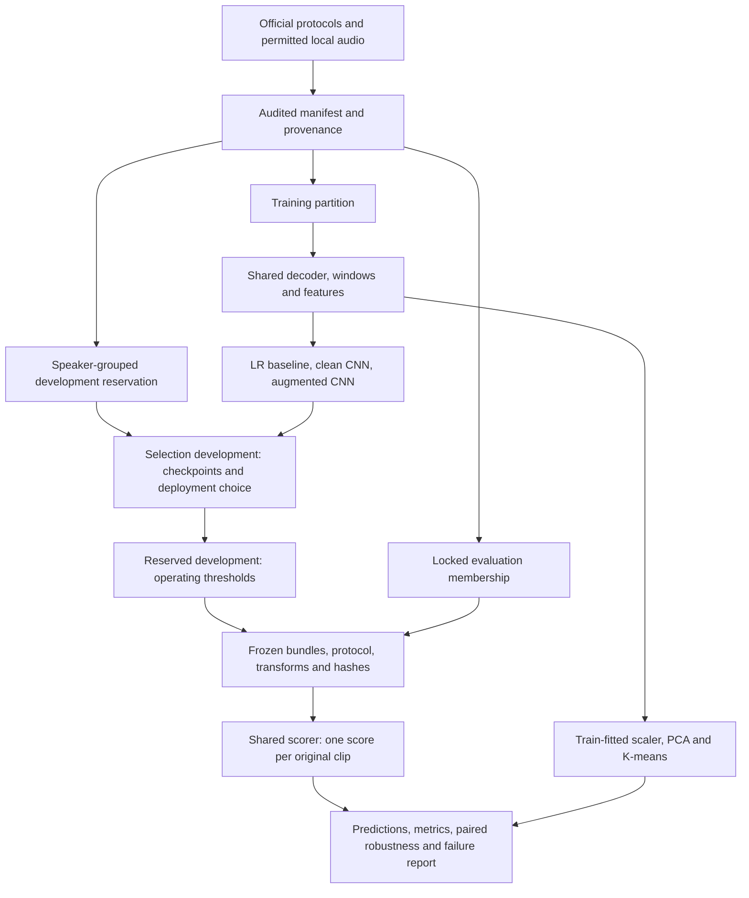
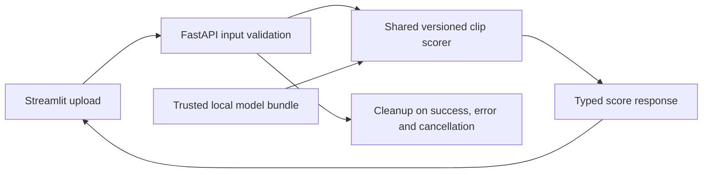

# Project workflow and pipeline

This is the planned implementation, not a claim that every module or service exists. Implemented so far: protocol parsing, the manifest builder, shared MFCC preprocessing and the serving skeleton. There is no trained model or evaluation harness yet. See [architecture and delivery decisions](architecture-and-delivery-plan.md) for contracts, acceptance tests, deadlines and remaining TODOs.

## Offline experiment path



Dataset sizes come from audited protocol counts, not estimates in this diagram. Dataset format comes from release documentation and verified decoding; the initial upload interface supports WAV/FLAC. Acquisition remains subject to published terms and a storage gate. No cloud storage is required.

Train/development feature exploration cannot use final-test outcomes. Split original clips before windows and augmentation. Fit statistical transforms on training only. Use the same deterministic clip scorer for development, locked evaluation and serving. Training augmentation and random cropping are separate, explicitly seeded training operations.

The locked comparison includes the baseline and both CNN training conditions, not just the deployed winner. Select the deployed bundle on selection development before evaluation. Set each reported model's threshold on reserved development speakers after model selection. Record the development false-alarm target of at most 5%; do not imply a final-test guarantee.

Robustness is clean audio, one declared compression setting and two declared noise levels, applied to both classes on the same source clips. Freeze codec/bitrate, noise construction, seeds, amplitude handling, membership and metric rules before final predictions. Speed and pitch changes are deferred. Report EER, macro F1, balanced accuracy, ROC AUC, class counts, confusion matrices, human false positives, synthetic detection, slice counts and grouped uncertainty.

## Serving path



The API owns decoding and inference. Streamlit calls it rather than loading another model. Load a verified bundle once per worker. Initially use one worker and bounded inference concurrency; increase only after measurement. The bundle contains the feature specification, training-fitted transforms, model parameters, score direction, aggregation rule, threshold and version/hash metadata.

Proposed response fields: `request_id`, `label`, `score`, `score_direction`, `threshold`, `model_version`, `preprocessing_version`, `duration_seconds`, and `processing_ms`. These are a contract to implement, not an existing endpoint. No `confidence` or probability field is planned. A spectrogram is an input visualization, not a causal explanation.

Proposed endpoints: `POST /predict`, `GET /health` (process alive), `GET /ready` (valid bundle loaded). Reject invalid decoded content and enforce byte, duration, decode-resource and concurrency limits. Upload target: WAV/FLAC, 1–30 seconds, at most 20 MB, subject to duration evaluation. Clean API temporary files and UI session buffers; exclude audio, filenames, local paths, request bodies and secrets from logs.

## Local packaging

Use one application image with two services/processes, API and Streamlit, orchestrated locally. Mount a trusted bundle read-only into the API; do not bake restricted audio or large checkpoints into Git or the image. Use temporary storage for uploads. Verify CPU container inference against the evaluated bundle within a declared numeric tolerance. Docker on the development machine is not an assumption of MPS access inside the container.

## Commands that exist today

These require a working Python 3.12/uv installation:

```bash
uv sync --frozen --all-groups
uv run voice-detector smoke --config configs/default.yaml
uv run ruff check .
uv run pytest
uv run voice-detector protocol-audit --protocol <cm-protocol-file> --split <train|development|evaluation>
uv run voice-detector build-manifest --la-root data/raw/LA
```

`build-manifest` reads audio headers and must run where the dataset lives (the training host). Data, training, freeze/evaluation, API, Streamlit and Docker commands must be implemented and tested before being documented as runnable. Their intended boundaries are in the architecture plan; the earlier speculative commands have been removed.
