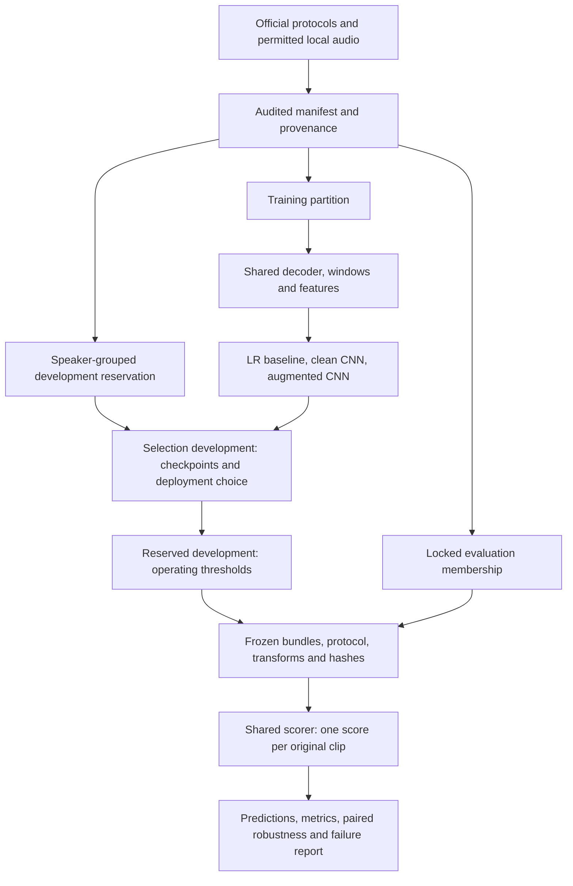
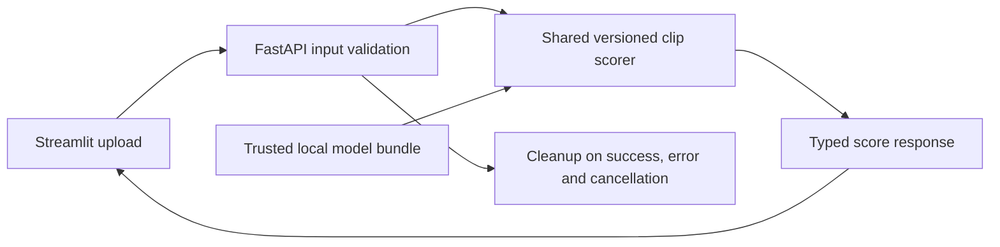

# Project workflow and pipeline

This document describes what is implemented. The offline experiment path and the serving path both exist: five candidate models (LR baseline and four CNN runs) were trained and evaluated under the locked protocol (REPORTED), and the deployed model (`cnn_augmented_seed1`) is served through FastAPI and Streamlit and packaged in Docker. The training-fitted PCA/K-means diagnostics and the shortcut-only baseline are **not implemented** (open in [`../TODO-Plan.md`](../TODO-Plan.md)). See the [reproduction guide](reproduction.md) for commands, the [model card](model-card.md) for measured results and the [architecture plan](architecture-and-delivery-plan.md) for design contracts.

## Offline experiment path

Dataset sizes come from the audited protocol counts in [`data.md`](data.md). The upload interface supports WAV/FLAC. No cloud storage is used.

Train/development feature exploration cannot use final-test outcomes. Split original clips before windows and augmentation. Fit statistical transforms on training only. Use the same deterministic clip scorer for development, locked evaluation and serving. Training augmentation and random cropping are separate, explicitly seeded training operations.

The locked comparison includes the baseline and both CNN training conditions, not just the deployed winner. The deployed bundle is selected from development results only. In this project that rule was written down after the locked report had been read, so the choice is not a blind selection ([`deployed-model-decision.md`](deployed-model-decision.md)). Set each reported model's threshold on reserved development speakers after model selection. Record the development false-alarm target of at most 5%; do not imply a final-test guarantee.

Robustness is clean audio, one compression setting (Opus 24 kbps) and two noise levels (20 dB and 10 dB SNR), applied to both classes on the same source clips from `configs/robustness_spec.yaml`, plus an evaluation-only silence-trim shortcut diagnostic. Parameters, seeds, membership and metric rules were frozen before final predictions. Speed and pitch changes are deferred. Reports carry EER, macro F1, balanced accuracy, ROC AUC, class counts, confusion matrices, human false positives, synthetic detection and slice counts; the bootstrap interval is emitted for slice EER only ([`evaluation-protocol.md`](evaluation-protocol.md) section 6).

## Serving path

The API owns decoding and inference. Streamlit calls it rather than loading another model. Load a verified bundle once per worker. Initially use one worker and bounded inference concurrency; increase only after measurement. The bundle contains the feature specification, training-fitted transforms, model parameters, score direction, aggregation rule, threshold and version/hash metadata.

Response fields (implemented in `voice_detector.serving`, config in `configs/serving.yaml`): `request_id`, `score`, `score_direction`, `threshold`, `decision` (`flagged_spoof_like` or `not_flagged`, not a verdict), `decision_rule`, `n_windows`, `duration_seconds`, `source_sample_rate_hz`, `model_id`, `model_version`, `preprocessing_version`, `aggregation_rule`, `bundle_hash`, `processing_ms`, `warnings`, and a `notice`. There is no `label`, `confidence` or probability field. A spectrogram is an input visualization, not a causal explanation.

Endpoints: `POST /predict` (one multipart `file` part), `GET /health` (process alive), `GET /ready` (pinned bundle verified and warmup passed), `GET /model` (versions, pins, limits and limitations). The service loads the same bundle through the same `load_cnn_scorer` as evaluation, refuses to start if the bundle hash or the exact threshold differs from the pins in `configs/serving.yaml`, applies the evaluation torch settings, and scores one window set per clip. Uploads are WAV/FLAC (sniffed, not trusted by name), 1–30 seconds, at most 20 MiB; the byte cap is enforced on the stream, header limits are checked before decoding, decoding is in memory through the shared `load_waveform`, no audio is written by the service, and logs carry only allowlisted fields (no audio, filenames, scores or addresses). The threshold was fixed on clean development audio and does not transfer under codec or noise (issue #83); every response carries that caveat in `notice`. Run `voice-detector serve --check` to verify a host before serving.

## Local packaging

One application image (`Dockerfile`, linux/amd64, CPU-only torch wheels) runs two services, `api` and `ui`, orchestrated by `compose.yaml`: read-only root filesystem, tmpfs `/tmp`, all capabilities dropped, ports bound to `127.0.0.1`. The trusted bundle is mounted read-only; audio, artifacts and checkpoints are never baked into Git or the image. Container-versus-library score parity was checked on 198 development clips (maximum absolute difference 0.0, 0 decision flips; [`model-card.md`](model-card.md) section 6).

## Command inventory

Entry point: `uv run voice-detector <command>` (`src/voice_detector/cli.py`). Arguments and defaults for each command are in [`reproduction.md`](reproduction.md); `--help` is authoritative.

| Command | Stage | Reads audio | Needs dataset |
| --- | --- | --- | --- |
| `smoke` | Validate imports and runtime | no | no |
| `protocol-audit` | Count labels, attacks and speakers in an official CM protocol | no | protocol file only |
| `build-manifest` | Per-clip manifest (CSV and SQLite) with checksums | headers + hashing | yes |
| `reserve-development` | Freeze the speaker-grouped `select` / `threshold` split | no | manifest |
| `extract-features` | Pooled MFCC feature cache for train and development | yes | yes |
| `train-lr` | MFCC + Logistic Regression bundle and development report | no | feature cache |
| `cnn-pilot` | Synthetic-data CPU timing pilot | no | no |
| `train-cnn` | Log-Mel CNN bundle (`--augmented` for the augmented family) | yes | yes |
| `eval-freeze` | DRAFT to FROZEN evaluation record over declared bundles | no | manifest + bundles |
| `eval-score` | Score every frozen candidate and condition into a prediction store | yes | yes |
| `eval-report` | Metrics, slices and bootstrap intervals from a scored store | no | store |
| `eval-supplement` | Post-report supplementary analysis (outside Phase 1; needs explicit authorization on an evaluation store) | no | store |
| `serve` | FastAPI scorer; `--check` verifies the pinned bundle and exits | uploads only | bundle |

Streamlit: `uv run streamlit run src/voice_detector/ui.py`. Helper scripts in `scripts/`: `docker_smoke.sh`, `latency_benchmark.py`, `container_parity.py`, `archive_artifacts.sh`, `preflight.sh`, `setup_linux-vm.sh`, and the presentation helpers `generate_demo_clips.py`, `demo_backup.py`, `demo_setup.sh`.
