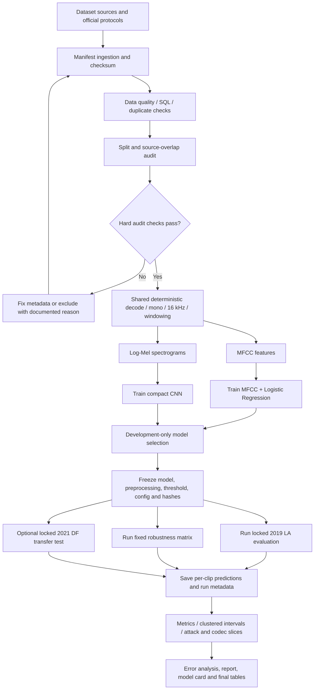
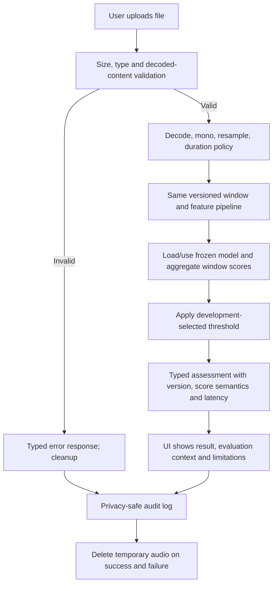

> **HISTORICAL / SUPERSEDED INPUT — NOT AN ACTIVE PLAN OR SOURCE OF TRUTH.**
> Header added 2026-11-06; the plan text below is unchanged.
>
> This document is an external planning input prepared on 26 October 2026. It was
> reviewed against this repository and **reconciled by PR #113** (merged
> 2026-10-27), which migrated the items that were genuinely missing and verifiable
> (the release sign-off record and waiver rule, the release hygiene sweep, "rehearse
> at least twice", the group-wise-bootstrap and train-only-fitting test item, the
> roadmap sign-off pointer, and three additions to `docs/research-backlog.md`) and
> recorded the decision **not to adopt this file** as repository documentation.
>
> Do not read it as project status, scope, design or a task list:
>
> - It states its own boundary: "The supplied GitHub `docs/` URL could not be
>   retrieved in this review environment. Therefore, items below are **required
>   verification points**, not claims that a particular implementation is absent."
>   Most of what it asks to verify was already implemented and documented.
> - Its §6 execution plan (Phase 0–6, 26 October – 4 November 2026) is **expired**
>   and was never the project's schedule. The gate sequence lives in
>   `docs/roadmap.md`; per-item completion lives in `TODO-Plan.md`. The presentation
>   was delivered on 5 November 2026.
> - Its prescribed filenames and checklists **must not be created**:
>   `DATASETS.md`, `EVALUATION_PROTOCOL.md`, `MODEL_CARD.md`, `REPRODUCIBILITY.md`,
>   `reports/data_audit.md`, `reports/phase_inventory.md`,
>   `reports/evaluation/model_comparison.csv`, `reports/evaluation/per_attack.csv`.
>   Equivalent documents already exist under their established lower-case names, and
>   adding these would reintroduce the competing-tracker problem PR #113 avoided.
>
> Authoritative documents are indexed in [`../README.md`](../README.md), which lists
> this file under "Not authoritative". Kept for provenance only. This file is
> untracked and is not to be committed or staged.

---

# Incremental Upgrades and Robustness Hardening

**Project:** AI Voice Deepfake Detector  
**Plan status:** Implementation-ready execution plan  
**Prepared:** 26 October 2026  
**Target presentation:** 5 November 2026 (the supplied course schedule is explicitly tentative)  
**Owner:** Solo implementation

---

## 1. Executive decision

### Decision: keep the current architecture; do not redesign from scratch

The proposal describes a coherent, appropriately scoped graduation project: a reproducible comparison between an MFCC + Logistic Regression baseline and a compact spectrogram CNN, evaluated for unfamiliar attacks and recording-condition shifts, then exposed through a small web demo with a transparent report. That maps directly to the graduation brief's requirements for a real problem, real data, an end-to-end AI/ML workflow, evaluation, and a working demonstration.

The next phase should be **incremental upgrades and robustness hardening**, not a new model architecture or a broad feature expansion. Preserve working code and existing documentation where they meet the contracts below. Change only components that fail an acceptance criterion or prevent reproducible evidence.

**Important review boundary:** this plan is grounded in the attached final proposal, the graduation-project guideline, and the Hebrew course syllabus. The supplied GitHub `docs/` URL could not be retrieved in this review environment. Therefore, items below are **required verification points**, not claims that a particular implementation is absent from the repository. Before coding, map each requirement to the existing file, test, report, or code path; do not duplicate an implementation that already passes.

### What is already well designed in the proposal

- A focused binary task: bona fide human speech versus synthetic/converted speech; not speaker identification, truth detection, or generator attribution.
- A clear classical baseline and a compact CNN comparison.
- An evaluation-first goal: test unfamiliar attacks, recording-condition changes, and a second domain rather than optimizing only a clean split.
- A stated separation between training, development/model selection, locked evaluation, and serving.
- A practical FastAPI + Streamlit + shared inference module design, packaged for local use.
- Reproducibility, dataset provenance, error analysis, a model card, privacy behavior, and latency measurements as explicit deliverables.
- Optional transformer embeddings, RAG, MCP, and cloud hosting are correctly ranked below the core project.

### Highest-value improvements to verify and implement

1. **Split and source-leakage audit:** show with executable evidence that related utterances, windows, chunks, transformed copies, and source-overlapping records cannot silently cross splits.
2. **A locked evaluation contract:** freeze the manifest, preprocessing, checkpoint, score direction, clip-level aggregation, and test predictions before using final evaluation labels for reporting.
3. **Development-only operating threshold:** choose the deployment threshold using a predeclared development subset; do not use the final test set to choose a threshold or retrain a model.
4. **One authoritative run record:** every result must trace to a run ID, configuration, Git commit, manifest hash, checkpoint hash, seed, dependencies, and saved per-clip predictions.
5. **Robustness evidence:** quantify clean-to-compressed/noisy degradation and break errors down by attack and codec where metadata supports it.
6. **Serving parity and failure handling:** the demo must use the same frozen preprocessing and model path as offline evaluation and must reject invalid uploads clearly.
7. **Release gate discipline:** complete the core experiment, report, and local demo before considering any extension.

---

## 2. Scope and priority rules

### P0 — must pass before calling the release complete

- Dataset inventory, provenance, checksums, label/split validation, and source-overlap report.
- Deterministic audio preprocessing and clip-level scoring/aggregation.
- MFCC + Logistic Regression baseline and compact CNN evaluated with one declared protocol.
- Development-only model/checkpoint selection and operating threshold.
- Locked primary evaluation, uncertainty intervals where feasible, per-attack analysis, and honest failure analysis.
- At least one fixed compression condition and two fixed noise conditions, applied consistently to both classes.
- Working local inference path with validation, useful errors, request/model metadata, and no raw audio retained by default.
- Reproducible commands, pinned/declarative environment, automated smoke tests, model card, and presentation evidence.

### P1 — do if the core gate remains green

- ASVspoof 2021 DF transfer evaluation, including a source-overlap audit and separate results.
- A second CNN seed to quantify training variability.
- A minimal calibration/reliability analysis if the UI needs to present probabilities rather than raw scores.
- Optional, small PCA/clustering plots used strictly as diagnostics.

### P2 — explicitly defer unless everything above is complete

- Frozen wav2vec 2.0 embeddings and a small classifier.
- RAG/evidence assistant, MCP, agents or multi-agent orchestration.
- Public cloud deployment.
- Live audio/call monitoring, speaker identification, generator attribution, multilingual performance claims, video deepfakes, or new model families.

**Rule:** an extension must never delay the locked evaluation, reproducibility, report, demo, or rehearsal. Do not add a new architecture just to demonstrate a syllabus topic.

---

## 3. High-level design requirements

### 3.1 Design principles

1. **One source of truth for audio preprocessing.** Training, offline evaluation, and online inference must invoke the same versioned decode/resample/mono/window/feature implementation, configured explicitly.
2. **Separate data, training, evaluation, and serving.** Serving must load a frozen artifact; it must never train, tune, or silently download a mutable checkpoint.
3. **Clip-level evaluation is authoritative.** Windows are an implementation detail. Metrics and reported sample counts must refer to original evaluation clips unless the report explicitly labels a window-level diagnostic.
4. **No test-driven development of the model.** Final evaluation labels must not guide hyperparameter search, threshold selection, preprocessing edits, checkpoint choice, or augmentation choice.
5. **Every result is traceable.** Metrics are derived from saved predictions and an immutable experiment record, not manually copied numbers.
6. **Fail safely and explain limitations.** Invalid, empty, silent, too-short, too-long, corrupt, or unsupported audio must return a clear error or a validated inconclusive state—not an unsupported authenticity claim.
7. **No unnecessary data retention.** User-uploaded audio is temporary and deleted after processing, including failure paths. Logs contain no audio bytes or raw upload payloads.
8. **Results describe measured scope, not universal detection.** Performance on ASVspoof does not establish performance on every current commercial generator, language, microphone, or phone codec.

### 3.2 Logical architecture

| Layer | Responsibility | Required output / contract |
|---|---|---|
| Dataset intake | Record dataset identity, provenance, license/terms, protocol files, and stable file IDs | Versioned manifest and data-access notes |
| Data quality and split audit | Check labels, split membership, duplicates, metadata, class balance, durations, clipping/silence, mapped source overlap | Machine-readable audit plus human-readable report; nonzero exit on hard violations |
| Shared audio pipeline | Decode, validate, convert to mono, resample to 16 kHz, handle duration, segment, and aggregate windows consistently | Deterministic waveform/window contract and preprocessing version |
| Feature pipeline | MFCC summary features for baseline; log-Mel spectrogram for CNN | Explicit feature configuration and tested tensor shape |
| Training | Train the baseline and CNN with development-only model selection | Checkpoint, configuration, seed, and training history |
| Evaluation | Produce locked per-clip predictions, metrics, uncertainty, robustness slices, and error tables | Reproducible report bundle; no model mutation |
| Artifact registry | Keep metadata, hashes, model version, threshold, and result paths | Run manifest and model manifest; avoid committing licensed audio or huge data artifacts |
| Inference library | Load frozen model + exact preprocessing + threshold; return typed assessment | Same result for identical input/artifact/configuration within the declared numerical tolerance |
| API | Validate requests, map known failures to stable responses, expose health and prediction routes | Versioned request/response schema and meaningful HTTP codes |
| UI | Upload audio, display score/class/model version/latency/limitations and evaluation context | Demo that uses the API/shared inference path; no claims that a spectrogram explains causality |
| Observability and governance | Track request ID, model version, duration, status, latency; delete audio; document intended use | Privacy-safe logs, measured p50/p95, model card, and release checklist |

### 3.3 Recommended repository organization (adapt to the existing repository)

Do **not** reorganize working code solely to match this sketch. Reuse current modules if they already provide the same boundaries.

```text
configs/
  data.yaml
  baseline.yaml
  cnn.yaml
  evaluation.yaml
src/
  data/          # manifest, catalog, quality checks, source/split audit
  audio/         # decode, validation, resampling, duration/window policy
  features/      # MFCC and log-Mel transforms
  models/        # model definitions and model loading
  training/      # baseline/CNN training and checkpoint selection
  evaluation/    # metrics, thresholds, bootstrap, robustness, error analysis
  inference/     # shared predict function and typed result
  api/           # FastAPI routes/schemas/errors
  ui/            # Streamlit interface, if kept in a separate module
 tests/
 reports/
  data_audit.md
  eda/
  evaluation/
 artifacts/       # small metadata and reports; large data/model files may be external
 docs/
  MODEL_CARD.md
  DATASETS.md
  EVALUATION_PROTOCOL.md
  REPRODUCIBILITY.md
```

---

## 4. Low-level design and implementation contracts

### 4.1 Dataset manifest and metadata catalog

Create or verify one canonical CSV manifest, with one row per **original clip**. Store derived windows/transforms in separate rows or files linked to that original, never as independent clips without parent linkage.

**Required fields when available:**

- `clip_id` — stable dataset-relative identifier.
- `dataset`, `dataset_version`, `source_path` or stable archive-relative path.
- `sha256` — file checksum; optionally a canonical decoded-waveform hash for duplicate investigation.
- `label` — canonical values `bonafide` or `spoof`.
- `official_split` — e.g. `train`, `dev`, `eval` as supplied by the dataset protocol.
- `project_split` — explicit training/model-selection/threshold split if development is subdivided.
- `speaker_id`, `source_id`/`utterance_id`, `attack_id`, `codec`, `subset` and other source-map metadata when supplied.
- `duration_seconds`, `original_sample_rate`, `channels`, decoded duration, and data-quality flags.
- `license_or_terms_ref`, `source_map_version`, and ingestion timestamp/version.
- For derived samples: `parent_clip_id`, transform name/configuration/seed, window start/end, and transform version.

**Rules:**

- Never infer an attack, speaker, or codec ID from a filename unless the mapping is formally documented and tested.
- Do not replace the official split label. Keep official and project-specific partitions separately.
- Exact duplicate detection is mandatory. Near-duplicate checks should be used where practical, especially after decoding/resampling.
- Use source maps published by ASVspoof to audit shared underlying source recordings between 2019 and 2021. Report overlap rather than treating overlapping recordings as independent evidence.
- Use SQL queries to verify counts, join integrity, duplicate IDs, missing labels, and split/source relationships.
- Do not redistribute dataset audio unless its terms permit it. Commit instructions and manifests, not licensed audio by default.

**Hard failures:** missing labels, conflicting labels for one original clip, duplicate clip IDs, a source group crossing project splits where it should be grouped, or any train/test leakage caused by derived windows/transforms.

### 4.2 Data audit and exploratory analysis

Generate a machine-readable `data_audit.json` plus `reports/data_audit.md` and EDA figures. Include:

- Number of original clips by dataset, official split, project split, class, attack, codec, and source/speaker where known.
- Duration and sample-rate distributions, decode failures, silence/near-silence, clipping, corrupt files, channel counts, and class imbalance.
- Exact duplicates and source-map overlap, with IDs/counts and handling decision.
- Missing metadata rates; explicitly distinguish “not available” from “not applicable”.
- Confirmation that test labels are not used by the data-preparation code to choose filters or parameters.

Do not “clean away” difficult evaluation samples because their predictions are inconvenient. Exclusions require a predeclared technical reason, a recorded list, and counts by label/split.

### 4.3 Audio preprocessing and clip-level aggregation

Define a versioned configuration for the following and use it everywhere:

1. Validate the decoded file—not just the extension or MIME string.
2. Decode with a maintained audio library; cap memory, file size, decoding time, and duration.
3. Convert to mono using one documented rule.
4. Resample to 16 kHz using one documented implementation.
5. Detect empty/corrupt input and apply a documented silence/near-silence policy.
6. Enforce the supported demo duration range (proposal: 1–30 seconds) and upload cap (proposal: 20 MB). If training uses a different minimum, document it and make UI behavior honest about that mismatch.
7. Use four-second training windows as the initial plan; record the crop strategy and random seed. For validation and tests, use deterministic windows.
8. Score an original clip once by aggregating its windows using one predeclared strategy (recommended: average window logits/scores before applying the threshold; if a different strategy is already proven, retain it and document it).
9. Record the window count and any padding/truncation behavior. Avoid silently discarding the beginning/end of an uploaded clip.

**Critical invariant:** all windows/transforms derived from one original clip remain in the same split. The baseline and CNN metrics use the same set of original clips and the same label/protocol definition.

### 4.4 Model contracts

#### MFCC baseline

- MFCC extraction parameters, aggregation statistics, scaling, and label mapping are versioned.
- Use a Scikit-learn pipeline so any scaler and classifier are fitted only on training data.
- Use Logistic Regression with a declared regularization/tuning budget and consistent imbalance handling.
- Save the fitted pipeline—not only the estimator—and record its feature configuration.

#### Compact CNN

- Use log-Mel spectrogram input with explicit parameters (sample rate, FFT/window/hop sizes, number of Mel bins, frequency range, amplitude/log floor, normalization, and tensor layout).
- Estimate any dataset normalization statistics from training data only.
- Record architecture, loss, class weights, optimizer, learning rate, batch size, maximum epochs, early-stopping patience, checkpoint rule, and random seed.
- Save the best development-selected checkpoint and training/validation curves.
- At least one repeat seed is required; a second seed is recommended if the measured compute budget permits. If only one seed is feasible, label training variability as unestimated.

#### Optional transformer enhancement

Only proceed when all P0 acceptance criteria pass and there is a working local demo. Freeze the encoder; cache embeddings; fit the small classifier using the same training/development rules. Report its external-pretraining status and inference/resource costs separately. Do not imply it is an official ASVspoof challenge-comparable submission.

### 4.5 Model selection, threshold, and metrics

**Before final evaluation:** commit `EVALUATION_PROTOCOL.md` defining the model-selection rule, score direction, thresholds, metrics, subsets, bootstrapping unit, and exclusion rules.

- Use the official 2019 LA training split for supervised fitting, development for model selection/threshold selection, and the official 2019 LA evaluation split as the locked primary test.
- If development is subdivided, group by speaker/source where possible, ensure both classes are present, save the split IDs, and do it before reading final test scores. Because the official development set is limited, document the sample-size/variance trade-off. If a reliable subgroup cannot be formed, use one fixed, fully documented development protocol rather than improvising after test results are seen.
- Select the deployable checkpoint using development results only. Freeze it before the final test.
- Choose the operating threshold on development data. The proposed operating objective is human-speech false-positive rate (FPR) at or below 5% on the threshold-selection data, with synthetic detection rate as high as feasible at that constraint. If the target is not achieved reliably, report that fact; do not adjust it against the test set.
- Calculate EER from the locked test scores as a reported benchmark metric, but never use the test-derived EER threshold to set the deployed operating threshold or to retrain/select the model.
- Report probabilities only if calibration is fitted on development data and validated (e.g. reliability diagram and Brier score). Otherwise call the output a **model score**, not a probability/confidence of authenticity.
- Ensure `spoof` score direction is positive and test metric functions with synthetic labels/scores to prevent sign inversions.

**Required metrics on original clips:** EER, ROC AUC, balanced accuracy, macro F1, confusion matrix, human FPR, synthetic detection rate/recall, class counts, selected development threshold, and 95% confidence intervals where feasible. Report both threshold-independent and fixed-threshold metrics with clear labels.

**Uncertainty:** use a reproducible clustered bootstrap (recommended 1,000 resamples) grouped by the original utterance/source recording so related transformed copies and generated versions are not treated as independent observations. If the source group is unavailable, state which available group was used and why. Do not bootstrap windows as independent samples.

### 4.6 Locked evaluation and transfer testing

#### Primary evaluation: ASVspoof 2019 LA evaluation

- Preserve the official protocol; verify attack IDs classed as known/unseen from the metadata.
- Report overall results and per-attack results with sample counts.
- Do not change the preprocessing or checkpoint after reviewing test errors. Error diagnosis is allowed for the final report; any subsequent changes become a new experiment and require a new untouched evaluation set to support a new headline claim.

#### Transfer evaluation: ASVspoof 2021 DF (P1)

- Keep it evaluation-only for this project unless a clearly authorized, separate training experiment is explicitly described.
- Audit source overlap using published source maps; report the full set and, if feasible, a no-overlap subset as separate, clearly labeled results.
- Preserve the complete available test protocol; do not balance the locked test by dropping examples without an explicit analysis objective.
- Break out available codec/source/attack/vocoder metadata; note missing metadata and severe class imbalance.
- Present 2021 DF as a separate domain/transfer result, not an independent test if sources overlap.
- If access/time fails, keep the 2019 LA primary test and state the transfer experiment as unavailable. This is an acceptable scope reduction; silently omitting the failure is not.

### 4.7 Robustness experiment

Run the same frozen checkpoint(s) on the same original test clips in each condition. The transform configuration and random seed are fixed in advance, applied consistently to both bona fide and spoof audio, and recorded in the report.

Minimum matrix:

| Condition | Definition | Required comparison |
|---|---|---|
| Clean | Canonical 16 kHz mono input | Reference result |
| Compression | One fixed, documented lossy codec setting | Change vs. the same clean originals |
| Noise — mild | Additive noise at a fixed SNR (recommended initial value: 20 dB) | Change vs. clean originals |
| Noise — stronger | Additive noise at a fixed SNR (recommended initial value: 10 dB) | Change vs. clean originals |

A reasonable initial compression setting is MP3 at 64 kbit/s, but the exact codec/tool/version must be pinned and the setting frozen before inspecting scores. If an existing configuration is already implemented, retain it if it is deterministic and documented rather than changing it for appearance.

Also evaluate a trained-with-augmentation model against the clean-trained model only if the extra training is feasible. In that comparison, keep the final evaluation clips and metrics fixed. Report, per condition: EER, balanced accuracy, macro F1, fixed-threshold human FPR and synthetic recall, score counts, and absolute delta from clean. Do not claim that synthetic noise testing represents all real environments.

### 4.8 Error analysis, PCA, and clustering

- Export per-original-clip predictions with true label, score, fixed-threshold output, attack/codec/source metadata, duration, and relevant data-quality flags.
- Review false alarms (human classified as spoof) and misses (spoof classified as human) separately.
- Provide a small table of the most important error slices with denominators; do not rank slices with tiny sample counts as reliable findings.
- PCA/clustering are diagnostics only: fit transformations/clusters on training data or a declared diagnostic set without leaking final labels into fitting. Plots do not prove authenticity or explain the model causally.
- Save a handful of representative error IDs and metadata; do not publish private/licensed audio samples without permission.

### 4.9 Inference, API, and UI behavior

The API/UI must call a single shared `predict_audio(...)`-style inference function. That function loads a frozen versioned artifact and returns a typed result, not ad hoc values assembled by the UI.

**Suggested response schema:**

```json
{
  "request_id": "...",
  "model_version": "...",
  "preprocessing_version": "...",
  "prediction": "spoof",
  "score": 1.234,
  "score_semantics": "uncalibrated_model_score",
  "threshold": 0.987,
  "processing_ms": 123.4,
  "duration_seconds": 4.2,
  "status": "ok",
  "limitations": ["Benchmark performance does not establish authenticity"]
}
```

This is a contract example, not a requirement to copy these exact field names if equivalent typed schemas already exist. The important requirements are stable meaning, explicit versioning, and score semantics.

**Input and error behavior:**

- Accept the formats claimed by the UI (proposal initially names WAV and FLAC). Do not advertise a format unless the decoder is tested for it.
- Validate actual decoded content, audio duration, size, sample rate/channel conversion, and model availability.
- Return understandable errors for empty/corrupt files, unsupported codecs, clips outside the allowed range, decode timeout, unavailable checkpoint, and inference exceptions.
- Use stable HTTP statuses and typed error bodies. Do not return a successful prediction when model loading or decoding failed.
- Avoid path traversal, trusting client filenames, unsafe deserialization, shell interpolation, unbounded decompression, and unbounded memory/work.
- Keep uploads in memory or an isolated temporary location; delete them in a `finally`/cleanup path on both success and failure. Logs must not include audio bytes, base64 content, or user audio paths.
- Include health/readiness behavior. A readiness check must fail if the model cannot load; a simple process-alive response is insufficient.
- If the UI shows “inconclusive”, the abstention band must be selected on development data and evaluated for both coverage and errors among decided samples. Otherwise do not show that label.
- Display model/version, score meaning, applicable evaluation summary, limitations, and measured processing time. A spectrogram is a visualization of input signal, not proof or a causal explanation.

### 4.10 Observability and performance

Log only privacy-safe structured fields:

- request ID, model/preprocessing version, status/error category, duration, and total latency;
- optional decoder, feature, model-inference, and serialization timing where useful;
- never raw audio, base64 bytes, or sensitive path information.

Measure on named hardware/software with a repeatable script:

- p50 and p95 end-to-end latency after stating whether cold-start/model-loading time is included;
- decode, preprocessing, inference, and total timing if separable;
- peak process memory or a clear proxy, and failure rate over a small fixed smoke-test batch;
- concurrent-request behavior appropriate to local demo use.

There is no universal latency requirement in the supplied brief. Record the measured values and establish a practical ceiling for the actual demo hardware; do not invent or claim a production SLA.

### 4.11 SQLite and experiment tracking

Keep SQLite small and metadata-only. Suggested entities:

- `dataset_versions`: source, version, terms reference, protocol/source-map hashes;
- `clips`: stable clip ID, label, split, source/speaker/attack/codec metadata, checksum and quality flags;
- `runs`: run ID, Git commit, config hash, manifest hash, seeds, environment, model path/hash, threshold, status;
- `predictions`: run ID, clip ID, score, predicted class at fixed threshold, condition, elapsed time;
- `artifacts`: run ID, artifact type, relative path, hash.

Raw data is not stored in SQLite. Provide one repeatable export of the metadata/result tables to CSV/JSON. Metric summaries must be recomputable from the saved predictions.

---

## 5. End-to-end pipeline flow

### 5.1 Research/training/evaluation pipeline



### 5.2 Serving pipeline



### 5.3 Non-negotiable invariants

- The offline evaluator and demo use identical model and preprocessing artifacts.
- A source clip and all derived windows/transforms never span independent splits.
- The final evaluation does not choose the selected model or deployment threshold.
- Every reported number can be regenerated from saved predictions plus run metadata.
- Invalid input produces an explicit error, never a fabricated prediction.
- A missing optional data source is recorded as unavailable, not silently replaced or described as completed.

---

## 6. Execution plan: 26 October–4 November 2026

The presentation is listed for 5 November. This is a short release window, so prioritize the required core and use explicit gates. If actual repository status shows an item is already implemented and evidenced, mark it complete and move to the next unmet gate.

### Phase 0 — Repository inventory and scope freeze (26 October)

- [ ] Map each requirement in this plan to current source code, tests, docs, and artifacts.
- [ ] Record current Git commit, branch status, Python/dependency environment, artifact locations, and what can run from a clean checkout.
- [ ] Identify the exact manifest, split protocol, best checkpoint, threshold, model config, and reported metric files.
- [ ] Freeze core scope. No new model architecture, RAG, MCP, agent, or cloud work until the release gate passes.

**Deliverable:** `reports/phase_inventory.md` or an equivalent existing file with `implemented + evidence`, `needs hardening`, `missing`, and `not feasible before presentation` status. No status should be marked complete without evidence.

**Exit gate:** one agreed route from data manifest to locked predictions and from upload to inference is identified.

### Phase 1 — Data integrity and preprocessing contract (26–27 October)

- [ ] Rebuild or verify the canonical manifest with stable IDs and hashes.
- [ ] Verify the official 2019 LA split/protocol and labels.
- [ ] Run duplicate and source/utterance mapping audits; inspect 2019/2021 source maps if 2021 is used.
- [ ] Verify no derived windows/augmentations leak across splits.
- [ ] Generate/review EDA and data audit reports.
- [ ] Pin the mono/16 kHz/window/padding/clip-aggregation policy and test deterministic repeatability.
- [ ] Test metric class-label and score-direction conventions with synthetic toy scores.

**Deliverables:** manifest hash, data audit, EDA plots, split-audit output, preprocessing config, and tests.

**Exit gate:** no unresolved hard leakage issue; all exclusions and missing metadata are documented.

### Phase 2 — Reproducible baseline and CNN evaluation (27–29 October)

- [ ] Freeze one evaluation protocol document and a run config for every model.
- [ ] Verify the MFCC feature pipeline and fitted scaler/classifier use training data only.
- [ ] Verify the CNN checkpoint is chosen only with development data and training is configured with an explicit seed and early-stopping rule.
- [ ] Ensure both models score the same original evaluation clips and report clip-level metrics.
- [ ] Save scores/predictions before generating final tables.
- [ ] Recompute EER, AUC, macro F1, balanced accuracy, confusion matrix, human FPR, and synthetic recall from saved predictions.
- [ ] Add a reproducible clustered bootstrap if time allows; at minimum document uncertainty limitations.
- [ ] Audit any previously reported clean-set scores for run ID, partition, manifest, threshold, and commit before using them as headline results.

**Deliverables:** baseline/CNN run records, frozen per-clip predictions, metrics JSON/CSV, confusion matrices, training curves, and a comparison table.

**Exit gate:** anyone can trace each metric to an immutable run/prediction bundle; no final-test result has been used to tune the model or operational threshold.

### Phase 3 — Robustness and failure analysis (29–30 October)

- [ ] Run the clean/compression/two-noise matrix on the same original clips.
- [ ] Confirm transforms affect both classes consistently and record the exact tool/configuration/seed.
- [ ] Report absolute changes from clean and sample counts per slice.
- [ ] Report per-attack results on the 2019 LA evaluation set.
- [ ] Run ASVspoof 2021 DF transfer evaluation only if data access, source mapping, runtime, and the core deadline permit.
- [ ] Review false positives and false negatives; select representative error IDs and quantify error slices.
- [ ] Do not modify the chosen model based on these final-test findings. Any changed model must be labeled as a new experiment, not substituted into the locked report.

**Deliverables:** robustness matrix, attack/codec tables, error-analysis report, and optional separately labeled 2021 transfer table.

**Exit gate:** the report documents both where the model works and where it fails, without unsupported claims of universal generalization.

### Phase 4 — Inference hardening and local demo (30–31 October)

- [ ] Verify API/UI use the shared inference function and frozen artifact.
- [ ] Test valid WAV/FLAC examples and all invalid-input cases listed in Section 4.9.
- [ ] Verify file deletion on successful and failed requests; inspect logs for accidental payload/audio content.
- [ ] Verify stable typed response/error schemas, health/readiness, model version, threshold, score semantics, duration, and processing time.
- [ ] Confirm UI limitations and evaluation context are visible; do not call a raw score a probability.
- [ ] Run the application from a clean environment/container using documented commands.
- [ ] Measure end-to-end p50/p95 latency and memory on named hardware; record whether cold start is included.

**Deliverables:** smoke-test log, container/local-start evidence, example API response, error-handling tests, and latency report.

**Exit gate:** local demo works reliably without model training or downloads at request time; a saved local fallback is ready.

### Phase 5 — Reproducibility, governance, and release docs (1 November)

- [ ] Run the documented pipeline from a fresh checkout or a clean environment to the extent dataset access permits.
- [ ] Pin dependencies or provide a lockfile/fully declared tested environment.
- [ ] Make one documented command run the required tests; keep a separate slower command for expensive training/evaluation.
- [ ] Verify CI includes unit/smoke tests for feature shapes, metric conventions, manifest/split leakage, invalid API input, and cleanup behavior.
- [ ] Complete `MODEL_CARD.md`, dataset notes, evaluation protocol, run manifest, limitations, and reproduction instructions.
- [ ] Verify no secrets, local absolute paths, raw uploads, private recordings, or restricted dataset audio were added to Git.
- [ ] Export final report tables and figures from scripts, not manually edited values.

**Deliverables:** release docs, model card, test log, environment manifest, reproducible result bundle, and clean repository status.

**Exit gate:** a reviewer can understand intended use, data, split choices, model, threshold, measured performance, limitations, and reproduction steps without asking for undocumented context.

### Phase 6 — Presentation freeze and rehearsal (2–4 November)

- [ ] Freeze model, config, threshold, predictions, report, and demo content; tag or record the release commit.
- [ ] Prepare a presentation capped at 12 minutes. Do not show code.
- [ ] Prepare a local demo with fixed, consented/licensed sample clips and a predictable network-independent path.
- [ ] Save screenshots and a short screen recording as backup; also prepare a static slide with the result if the demo fails.
- [ ] Rehearse the complete flow at least twice and verify all result numbers match the final report.
- [ ] Prepare one clear slide on failure modes and limitations, including domain shift and the fact that the detector cannot prove authenticity.

**Exit gate:** both a live demo and a no-network backup can demonstrate the end-to-end product; presentation fits the time limit.

### Suggested 12-minute presentation outline

| Time | Content |
|---|---|
| 0:00–1:00 | Problem, motivation, scope, and research questions |
| 1:00–3:00 | Data, official partitions, source-overlap/leakage controls, and EDA |
| 3:00–5:00 | MFCC baseline versus CNN; explain choices, not code |
| 5:00–8:00 | Primary results, unseen attacks, robustness deltas, representative failures |
| 8:00–10:00 | Live demo or recorded backup |
| 10:00–11:00 | Limitations, threshold meaning, intended use, and privacy behavior |
| 11:00–12:00 | Conclusion and next research steps |

---

## 7. Acceptance criteria and sign-off checklist

**Release status is complete only when all P0 items pass or a documented, defensible limitation is approved.** “It runs on my machine” or “the score is high” is not acceptance evidence.

| ID | Acceptance criterion | Evidence / sign that it is in place | Status |
|---|---|---|---|
| AC-01 | Scope and current implementation inventory exist | Inventory lists each requirement, current code/test/doc evidence, and unresolved gaps | [ ] |
| AC-02 | Data source and terms are documented | Dataset notes name source, version, terms/license reference, protocol/source map, and allowed artifact sharing | [ ] |
| AC-03 | Canonical manifest is reproducible | Manifest + hash can be regenerated or verified; IDs/checksums/labels/splits are stable | [ ] |
| AC-04 | Split/source leakage audit passes | Automated audit proves no original clip, derived window, or transformation crosses prohibited splits; exceptions are documented | [ ] |
| AC-05 | Data quality and EDA are documented | Class/split/attack counts, duration/sample-rate distributions, silence/clipping, decode failures, and duplicates are reported | [ ] |
| AC-06 | Preprocessing is deterministic and versioned | Config lists sample rate, channels, duration/window policy, features, normalization, padding, and aggregation; repeat test passes | [ ] |
| AC-07 | Baseline is reproducible | Baseline checkpoint/pipeline, config, seed, environment, training command, and predictions exist | [ ] |
| AC-08 | CNN checkpoint selection is development-only | Config/training history show early-stopping/checkpoint rule; no final-test tuning | [ ] |
| AC-09 | Both models use a fair comparison protocol | Same original clips, labels, split, scoring units, and metric implementation; any difference is disclosed | [ ] |
| AC-10 | Metrics and score orientation are tested | EER/AUC/F1/balanced accuracy/FPR/recall tests pass on known toy examples; spoof score direction is explicit | [ ] |
| AC-11 | Operating threshold is development-selected | Threshold, selection rule, and development FPR/recall are saved; no threshold chosen from locked test | [ ] |
| AC-12 | Locked primary result is reproducible | Immutable per-clip predictions and run metadata regenerate the reported 2019 LA evaluation table | [ ] |
| AC-13 | Unfamiliar-attack behavior is reported | Per-attack table includes counts and makes known/unseen distinction clear | [ ] |
| AC-14 | Robustness matrix is complete | Clean, one fixed compression setting, and two fixed noise levels; same source clips; config, seed, and absolute deltas saved | [ ] |
| AC-15 | Error analysis is grounded in results | False positives and misses are examined; error slices include denominators; limitations are acknowledged | [ ] |
| AC-16 | Confidence/uncertainty is handled honestly | Cluster bootstrap intervals or an explicit reason they could not be completed; no window-level pseudo-independent interval | [ ] |
| AC-17 | Transfer result is either completed or explicitly unavailable | If 2021 DF is used, it has separate results and source-overlap audit; otherwise limitation is explicit | [ ] |
| AC-18 | Offline inference and demo share the same pipeline | Model/preprocessing versions match; golden input predictions match within a stated tolerance | [ ] |
| AC-19 | Invalid uploads fail safely | Tests cover corrupt/empty/silent/unsupported/oversized/too-short/too-long input and missing model | [ ] |
| AC-20 | Uploaded audio is not retained by default | Cleanup succeeds after success and failure; logs contain no audio payload or raw upload content | [ ] |
| AC-21 | API/UI contract is understandable | Typed responses/errors, model version, score semantics, latency, limitations, and health/readiness are present | [ ] |
| AC-22 | Performance is measured, not guessed | Named hardware/software, test batch, p50/p95 latency, memory proxy, and measurement conditions are recorded | [ ] |
| AC-23 | Local packaging is reproducible | Fresh checkout/container startup instructions pass; no network/model download is required during prediction | [ ] |
| AC-24 | CI/smoke tests cover critical regressions | Feature shapes, metric orientation, split leakage, API errors, and cleanup tests run via documented command | [ ] |
| AC-25 | Model card and dataset documentation are complete | Intended use, non-goals, data provenance, languages/conditions covered, threshold, errors, limits, versions, and privacy are stated | [ ] |
| AC-26 | Results are traceable to runs | Run records contain Git commit, config/dependency version, seed, manifest hash, checkpoint hash, threshold, and prediction artifacts | [ ] |
| AC-27 | Final report is generated from artifacts | Numbers/figures match saved predictions; final-test results were not used to revise the evaluated model | [ ] |
| AC-28 | Demo backup and presentation pass | ≤12 minutes, no code shown, two rehearsals, licensed/consented samples, local fallback/recording prepared | [ ] |
| AC-29 | Repository hygiene is clean | No secrets, local-only paths, unintended raw audio, disallowed data, or huge generated artifacts committed | [ ] |
| AC-30 | Final sign-off is explicit | Release commit/tag and completed checklist exist; every waived item has a reason, impact, and owner/date | [ ] |

### Required sign-off summary

At the end of the phase, fill in this block in the project docs:

```text
Release commit/tag:
Manifest hash:
Selected model and checkpoint hash:
Preprocessing version:
Operating threshold and selection rule:
Primary evaluation report path:
Robustness report path:
Test/CI command and result:
Demo startup command and result:
P0 unresolved items (must be empty or explicitly waived):
Approved scope limitations:
Final sign-off date:
```

---

## 8. Suggested test suite

Map these to the existing test framework; do not create duplicate frameworks if the repository already has one.

### Data and leakage

- Duplicate clip IDs and conflicting labels fail validation.
- Missing required labels or invalid split names fail validation.
- A source/window/transform group crossing independent splits is detected.
- Manifest checksum changes are reported.
- Audit counts reconcile with the manifest and SQL catalog.

### Audio and features

- Same file + same config produces equivalent waveform/features within a defined tolerance.
- Mono/stereo and non-16-kHz inputs normalize according to the documented policy.
- Empty, silent, corrupt, non-audio, too-short, too-long, and extremely large/decompression-heavy inputs are handled safely.
- MFCC and log-Mel shapes match model input specifications.
- Train-only normalization never fits from validation/test inputs.
- Clip-level aggregation returns exactly one score per original clip.

### Metrics and experiment integrity

- Metric functions pass tests with perfect, reversed, and random toy scores.
- Positive score direction and class labels are asserted.
- Threshold-selection function operates only on declared development predictions.
- Test reporting cannot accidentally invoke a threshold-tuning or training path.
- Bootstrap samples resample original groups, not windows.

### Serving/API

- Valid sample returns a schema-valid prediction and model/preprocessing versions.
- Invalid audio returns an explicit non-success status and safe error body.
- Missing/corrupt model artifact makes readiness fail.
- Upload cleanup runs even when decoding/inference raises an exception.
- Logs are scanned in tests for known audio payload strings/filenames where feasible.
- Inference golden test agrees with the offline evaluator for a fixed sample and frozen artifact.

---

## 9. Required documentation/artifact bundle

Use existing equivalents if they already exist. At minimum, the release should contain:

- `docs/INCREMENTAL_UPGRADES_AND_ROBUSTNESS_HARDENING.md` — this plan, updated with actual checkmarks and evidence links.
- `docs/DATASETS.md` — sources, versions, license/terms, protocol references, metadata limitations.
- `docs/EVALUATION_PROTOCOL.md` — split policy, score direction, metrics, threshold rule, bootstrap unit, robustness transforms, locked-test rule.
- `docs/REPRODUCIBILITY.md` — setup, versions, training/evaluation commands, deterministic settings, artifact retrieval.
- `docs/MODEL_CARD.md` — intended use, out-of-scope use, data and evaluation scope, measured errors, limitations, score semantics, privacy/versioning.
- `reports/data_audit.md` and key EDA plots.
- `reports/evaluation/model_comparison.csv` and readable summary table.
- `reports/evaluation/per_attack.csv`, `robustness.csv`, and `error_analysis.md`.
- Run metadata plus per-original-clip prediction files with hashes.
- `reports/latency.md` and demo/API smoke-test log.
- Presentation deck plus local demo backup recording/screenshots.

Do not commit private user uploads or copyrighted/licensed audio simply to make the project self-contained. Document how an authorized reviewer can obtain the data and regenerate artifacts.

---

## 10. Risks and decision rules

| Risk | Mitigation / decision rule |
|---|---|
| Current repository already implements some planned items | Map requirements to evidence first; improve only unmet acceptance criteria. This is not a forced rewrite. |
| Data access or runtime threatens the deadline | Keep 2019 LA as the primary experiment; defer 2021 DF, second seed, transformer, RAG, MCP, and cloud before cutting reproducibility or the demo. |
| Very high clean-set result is not tied to the official locked test | Do not use it as a headline until the split, manifest hash, commit, predictions, and score protocol are verified. High performance alone proves neither leakage nor generalization. |
| Source overlap between datasets inflates apparent transfer evidence | Use source maps and report overlapping and no-overlap subsets separately when feasible; do not call them independent if they share sources. |
| Final-test error prompts model tuning | Keep the test as reporting-only; document the finding as a limitation or define a new experiment requiring a new untouched test set. |
| Test classes are imbalanced | Keep the official test intact and report class-specific metrics, EER, macro F1, balanced accuracy, class counts, and fixed-threshold operating metrics. |
| Probability language overstates certainty | Show a raw score unless calibration is implemented and evaluated on development data. |
| Optional course topics become a distraction | Only ship completed extensions with their own evaluation; core scope wins. |
| Live demo fails due to network or environment | Local container, preloaded model, licensed/consented samples, screenshots, and recording backup. |

---

## 11. Course and graduation alignment

The supplied graduation brief prioritizes a clearly defined practical problem, real data and early EDA, an end-to-end AI/ML system, an evaluation/data-driven conclusion, and a working demo. It also limits the final presentation to 12 minutes and explicitly says not to show code. The supplied Hebrew syllabus includes Python/software engineering, NumPy/Pandas/EDA/SQL, supervised learning and evaluation, clustering/PCA, CNNs, embeddings/transformers, retrieval/RAG, agents/MCP, governance, observability, cloud infrastructure, and end-to-end system engineering.

The project can demonstrate strong course alignment without implementing every topic:

| Course area | Project evidence | Priority |
|---|---|---|
| Python/software engineering | Reusable modules, tests, documented commands, configuration and clean interfaces | Core |
| Data lifecycle, EDA, SQL | Manifest, quality audit, EDA, source/split checks, SQLite catalog and queries | Core |
| Supervised learning and evaluation | MFCC + Logistic Regression versus CNN; metrics; threshold discipline; locked tests | Core |
| Neural networks/CNN | Training configuration, early stopping, checkpoint, curves and inference | Core |
| Generalization and robustness | Unseen attack slices, transfer-domain analysis if feasible, codec/noise ablation | Core |
| PCA and clustering | Small diagnostic analysis of training features/error groups, if useful | Core evidence if already in plan; keep strictly diagnostic if time is short |
| Governance and control | Model card, intended use/non-goals, data terms, privacy and retention policy | Core |
| Observability/performance testing | Typed failures, health/readiness, latency/memory/failure measurements | Core |
| Cloud deployment/infrastructure | Reproducible local container first; cloud only if it is low risk and truly useful | Secondary |
| Embeddings/transformers | Frozen wav2vec 2.0 encoder and small head | Optional enhancement |
| Search/embeddings/RAG | Curated evidence assistant with measured retrieval/citation quality | Optional; defer |
| Agents/MCP/multi-agent systems | One bounded tool interface only if the core release is already done | Optional; defer |

---

## 12. References and source notes

### Supplied project materials

- **AI Voice Deepfake Detector — Final Project Proposal** (attached, 7 pages): project definition, ASVspoof data plan, MFCC/CNN/optional transformer, evaluation/uncertainty, FastAPI + Streamlit design, responsible use, course-topic mapping, delivery milestones.
- **AI Engineering Course Graduation Project** (attached PDF): real-world problem, real data, end-to-end solution, workflow, evaluation and demo; presentation up to 12 minutes; suggested motivation/problem/related work/data/method/results/limitations structure; no code during presentation.
- **AI Engineering course syllabus** (attached in Hebrew): Python, data/EDA/SQL, supervised and unsupervised learning, CNN, embeddings/transformers, RAG, agents/MCP, governance, observability, cloud deployment and end-to-end AI systems.

### External references to retain in project docs

- ASVspoof 2019 dataset and protocol description: https://datashare.ed.ac.uk/items/31074a11-b6f6-4e92-a4ad-07093f8c0c45
- Official ASVspoof 2021 release page, including DF data, evaluation keys/metadata, baseline code and 2019/2021/source-corpus file maps: https://www.asvspoof.org/index2021.html
- ASVspoof 2021 challenge repository and evaluation scripts: https://github.com/asvspoof-challenge/2021
- ASVspoof 2021 DF dataset card (metadata and data distribution information): https://huggingface.co/datasets/SpeechAntiSpoofingBenchmarks/ASVspoof2021_DF

**Source interpretation note:** ASVspoof 2019 LA uses speaker-disjoint train/development/evaluation partitions, and its evaluation includes attack algorithms/conditions not present in training/development. ASVspoof 2021 publishes source maps between the 2019/2021 sets and underlying speech corpora; use them to qualify transfer claims. These design facts support the audit requirements above, not a guarantee of generalization to all modern synthetic voice systems.

---

## Final operating instruction

Start by mapping the checklist against the current repository. Fix only the unmet P0 criteria, in priority order. Keep the model and architecture stable unless a test reveals a concrete correctness defect. Freeze test predictions before final reporting. The release is successful when the data lineage, experiments, robustness findings, demo, privacy behavior, and limitations are all reproducible and evidenced—even if results are weaker than hoped or an optional experiment cannot be completed.
